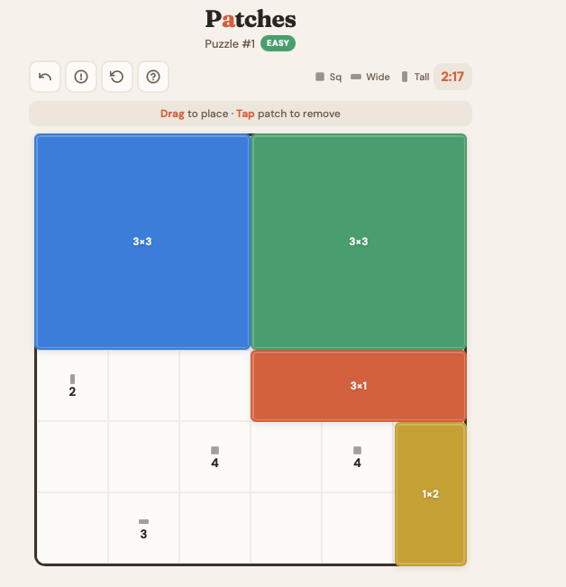

# Solver for Patches

## Overview

Patches is only of the daily puzzles available on LinkedIn.  You are given a grid populated with a number of pieces.  Each piece has a shape and optionally a target size.  You must increase the size of each of the pieces to ensure that the grid is fully covered.

An alternative version is available at https://www.patchesgame.com

## Solver

This program solves the puzzle by applying this two rules

1. If a cell can only be reached by a single piece,  then that piece should grow to cover that square.

2. If all possible growths of a piece include a given square,  then that piece should grow to cover that square.
